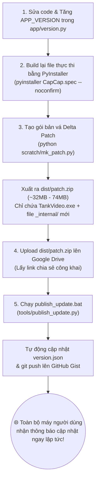
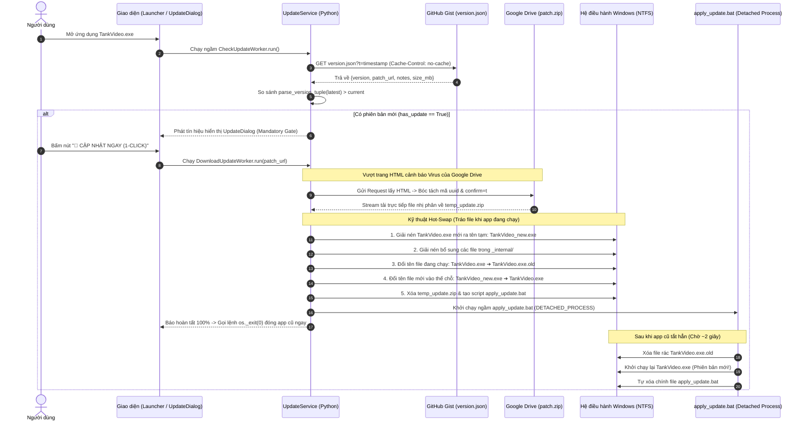

# 🔄 KIẾN TRÚC TỰ ĐỘNG HÓA CẬP NHẬT PHIÊN BẢN (AUTO-UPDATE AUTOMATION)

Tài liệu này giải thích chi tiết **cơ chế tự động hóa phát hành và cập nhật phiên bản mới (CI/CD & In-App OTA Update)** của dự án **TankVideo Studio (CapCap)**, bao gồm sơ đồ luồng hoạt động, cấu trúc các file tham gia, và **lý do kỹ thuật vì sao hệ thống phải thiết kế theo cách này**.

---

## 📌 1. Tổng quan các file tham gia vào hệ thống Auto-Update

| Nhóm | File trong dự án | Vai trò chính |
| :--- | :--- | :--- |
| **Cấu hình Version** | `app/version.py` | Lưu hằng số `APP_VERSION` hiện tại và đường dẫn `UPDATE_CONFIG_URL` (trỏ tới `version.json` trên GitHub Gist). |
| **Phía Developer (Phát hành)** | `scratch/mk_patch.py` | Tự động gom `TankVideo.exe` mới + các thư mục/file phụ thuộc mới trong `_internal/` nén thành `dist/patch.zip` siêu nhẹ. |
| | `tools/publish_update.py` | Tự động tăng số version (`auto_bump`), gọi đóng gói `patch.zip`, cập nhật `version.json` và tự động `git commit` + `git push` lên GitHub Gist. |
| | `publish_update.bat` | Phím tắt 1-Click dành cho Developer để chạy quy trình phát hành. |
| **Phía Client (Trong App)** | `app/services/update_service.py` | Lõi xử lý tự động cập nhật: kiểm tra phiên bản mới, vượt tường cảnh báo Google Drive để tải `patch.zip`, thực hiện kỹ thuật **Hot-Swap Rename** trên Windows và tự khởi động lại. |
| | `ui/dialogs/update_dialog.py` | Giao diện hộp thoại cập nhật chạy đa luồng (`CheckUpdateWorker`, `DownloadUpdateWorker`) và cổng khóa bắt buộc cập nhật (`Mandatory Update Gate`). |
| | `ui/views/launcher.py` & `ui/main_window.py` | Tự động kiểm tra ngầm (`check_update_quietly`) ngay khi người dùng mở ứng dụng. |
| **Cứu hộ độc lập** | `tools/update_tankvideo.bat` | Script cứu hộ chạy ngoài ứng dụng: tự động quét ổ đĩa (`Desktop`, `C:`, `D:`, `E:`) tìm thư mục cài đặt, tắt tiến trình cũ, tải bản vá qua PowerShell và giải nén. |

---

## 🗺️ 2. Sơ đồ Luồng Hoạt động Toàn diện (End-to-End Architecture)

### 2.1. Luồng Phát hành Phiên bản mới (Phía Developer / Admin)

---

### 2.2. Luồng Tự động Cập nhật 1-Click trong App (Phía Người dùng)

---

## 🧠 3. Giải thích Chi tiết Từng Bước Kỹ thuật trong Code

### Bước 1: Kiểm tra phiên bản chống dính bộ nhớ đệm (Cache-Busting Check)
Trong `UpdateService.check_for_updates()` (`app/services/update_service.py`):
* Hệ thống không gọi thẳng URL tĩnh mà luôn gắn thêm mốc thời gian hiện tại vào đuôi URL:  
  `f"{UPDATE_CONFIG_URL}?t={int(time.time())}"` kèm Header `"Cache-Control": "no-cache"`.
* **Mục đích**: CDN của GitHub (`gist.githubusercontent.com`) thường lưu bộ nhớ đệm (cache) từ 5–10 phút. Việc gắn `?t=...` ép máy chủ luôn trả về file `version.json` mới nhất vừa được bạn `git push` lên chỉ sau 1 giây.
* Hàm `parse_version_tuple()` chuyển chuỗi `"1.3.0"` thành bộ số nguyên `(1, 3, 0)` để so sánh toán học chuẩn xác (ví dụ hiểu đúng `1.10.0 > 1.9.0`, tránh lỗi so sánh chuỗi ký tự thông thường).

### Bước 2: Tự động bóc tách Google Drive cho File lớn (`_open_download_stream`)
Khi tải file `patch.zip` (~32MB – 74MB) từ Google Drive:
1. Google Drive chặn không cho tải trực tiếp các file `.zip` chứa `.exe` có dung lượng lớn, mà trả về một trang web HTML cảnh báo *"Google Drive không thể quét virus cho tệp này"*.
2. Hàm `_open_download_stream()` kiểm tra `Content-Type` trả về:
   * Nếu thấy `"text/html"`, nó tự động đọc mã nguồn trang web và dùng biểu thức chính quy (Regex) tìm 2 khóa bảo mật ẩn trong thẻ `<form>`:
     * `name="uuid" value="..."`
     * `name="confirm" value="..."`
   * Sau đó tự động ghép thành đường link tải trực tiếp từ máy chủ lưu trữ gốc:  
     `https://drive.usercontent.google.com/download?id={file_id}&export=download&confirm={confirm_val}&uuid={uuid_val}`
   * Nhờ vậy, ứng dụng tải thẳng luồng dữ liệu ZIP với thanh tiến trình `%` mượt mà ngay trong giao diện phần mềm mà không bắt người dùng mở trình duyệt web.

### Bước 3: Kỹ thuật "Hot-Swap Rename" ngay khi phần mềm đang mở
Trong `UpdateService.download_and_install_patch()`:
1. **Giải nén an toàn**: Đọc file `temp_update.zip`, trích xuất `TankVideo.exe` mới ra một tên tạm là **`TankVideo_new.exe`** (chưa đụng chạm gì tới file `TankVideo.exe` đang chạy) và chép bổ sung các thư mục `_internal/` nếu có.
2. **Đổi tên file đang chạy**: Đổi tên `TankVideo.exe` (đang chạy trên RAM) thành **`TankVideo.exe.old`**.
3. **Thế chỗ file mới**: Đổi tên `TankVideo_new.exe` thành **`TankVideo.exe`**.
   * *Cơ chế tự phục hồi (Rollback)*: Nếu bước 3 chẳng may bị lỗi, khối `except` sẽ tự động đổi tên `TankVideo.exe.old` quay trở lại thành `TankVideo.exe` để phần mềm của người dùng không bao giờ bị hỏng!
4. **Khởi động lại qua tiến trình độc lập**: Sinh ra file `apply_update.bat` chỉ gồm 5 dòng lệnh đơn giản (chờ 2 giây bằng `ping 127.0.0.1 -n 3`, xóa `TankVideo.exe.old`, bật `TankVideo.exe` mới, và tự xóa `.bat`), sau đó gọi `os._exit(0)` để đóng ngay tiến trình cũ.

---

## 💡 4. VÌ SAO PHẢI CẬP NHẬT THEO CÁCH NÀY? (5 Lý do Kỹ thuật Cốt lõi)

Nếu một kỹ sư phần mềm hoặc nhà tuyển dụng hỏi bạn: *"Tại sao không bắt người dùng tải lại bộ cài ফুল hoặc dùng script giải nén đè lên luôn mà phải thiết kế cầu kỳ như vậy?"*, đây là **5 lý do thực chiến cực kỳ thuyết phục**:

### Lý do 1: Giải quyết bài toán "Bộ cài AI khổng lồ (Hàng GB) vs Bản vá siêu nhẹ (Vài chục MB)"
* Một phần mềm AI chạy Offline trên máy trạm như **TankVideo** đi kèm với hàng loạt thư viện C++ và mô hình nặng: `PyTorch`, `CUDA 12 Runtime`, `Faster-Whisper`, `Sherpa-ONNX`, `RapidOCR`, `FFmpeg`, cùng các model giọng đọc `Piper`/`VieNeu`... Tổng dung lượng toàn bộ thư mục phần mềm lên tới **vài Gigabyte**.
* Tuy nhiên, khi bạn sửa lỗi giao diện, cập nhật thuật toán quét Douyin hay chỉnh sửa logic Workflow, **99% các thư viện AI và Model kia không hề thay đổi**! Toàn bộ mã nguồn Python của bạn đã được PyInstaller biên dịch gói gọn vào trong `TankVideo.exe`.
* Do đó, việc tách riêng cơ chế **Patch Update (`patch.zip` chỉ ~32MB – 74MB)** giúp:
  * Giảm **95% dung lượng mạng** phải tải.
  * Tốc độ cập nhật rút ngắn từ **30 phút xuống chỉ còn 5–10 giây**.
  * Không làm mất dữ liệu cá nhân, cấu hình `.env`, lịch sử dự án (`projects/`), hay các model AI người dùng đã tải sẵn trong máy.

### Lý do 2: Vượt qua cơ chế Khóa File nghiêm ngặt của Windows (`File Locking / WinError 5`)
* **Vấn đề**: Trên hệ điều hành Windows, khi người dùng đang mở `TankVideo.exe`, nhân hệ điều hành (Windows Kernel) sẽ khóa cứng file đó: **Bất kỳ lệnh nào cố tình XÓA (`del`) hoặc GHI ĐÈ (`overwrite` / giải nén đè) lên `TankVideo.exe` đang chạy đều sẽ bị báo lỗi `PermissionError: [WinError 5] Access is denied` ngay lập tức!**
* **Nhược điểm của cách cũ (Dùng file `.bat` để giải nén sau khi tắt app)**:
  * Nhiều máy Windows của khách hàng bị phần mềm diệt virus chặn PowerShell `Expand-Archive`, hoặc tiến trình cũ tắt chậm làm file `.bat` giải nén thất bại giữa chừng khiến phần mềm bị mất file `.exe` không mở lên lại được.
* **Giải pháp thông minh hiện tại (In-Process Rename Hot-Swap)**:
  * Hệ thống tệp **NTFS của Windows** có một đặc tính rất đặc biệt: **Mặc dù cấm xóa/ghi đè, nhưng Windows lại CHO PHÉP ĐỔI TÊN (`Rename / Move`) một file `.exe` đang chạy!**
  * Nhờ thực hiện toàn bộ việc Giải nén (`.zip` $\rightarrow$ `TankVideo_new.exe`) và Đổi tên (`TankVideo.exe` $\rightarrow$ `.old`, `TankVideo_new.exe` $\rightarrow$ `TankVideo.exe`) **ngay bên trong code Python khi app vẫn đang sống**, ta kiểm soát được 100% lỗi giải nén, có thanh `%` trực quan, và nếu lỗi thì tự khôi phục (`.old` $\rightarrow$ `.exe`) an toàn tuyệt đối. File `.bat` lúc này chỉ còn làm đúng nhiệm vụ bật lại app mới!

### Lý do 3: Hạ tầng "Zero-Cost" (Chi phí Server = 0 đồng) nhưng chịu tải cao
* Nếu tự thuê VPS làm máy chủ chứa file cập nhật: Khi có 100 người dùng cùng bấm cập nhật bản vá 50MB một lúc, máy chủ sẽ tốn hàng GB băng thông và dễ bị nghẽn mạng.
* Kiến trúc kết hợp **GitHub Gist (Lưu file cấu hình `version.json` vài KB)** + **Google Drive (Lưu file nặng `patch.zip`)**:
  * Hoàn toàn **miễn phí 100%**.
  * Tận dụng được hạ tầng đường truyền tốc độ tối đa của Google và GitHub trên toàn cầu.
  * Thuật toán tự bóc tách mã `uuid` và `confirm=t` trong `UpdateService` đã biến một link chia sẻ Google Drive thông thường thành một **Direct Download CDN** thực thụ.

### Lý do 4: Đảm bảo tính đồng bộ bằng "Mandatory Update Gate" (Cổng bắt buộc cập nhật)
* Đặc thù của phần mềm có tích hợp quét video đa nền tảng (Douyin, Bilibili, Xiaohongshu) và gọi API AI là khi các nền tảng đó đổi thuật toán bảo mật, phiên bản cũ trên máy khách sẽ bị lỗi.
* Bằng cách đặt `mandatory=True` khi phát hiện phiên bản mới trên Gist, ứng dụng chặn ngay tại màn hình chính (`LauncherWindow` / `MainWindow`), bắt buộc người dùng bấm nút **1-Click Update (5 giây)** mới được vào làm việc. Nhờ vậy bạn không bao giờ phải hỗ trợ kỹ thuật cho những người dùng còn kẹt ở phiên bản cũ lỗi thời.

### Lý do 5: Thiết kế Phòng thủ 3 Lớp (3-Tier Fallback)
Hệ thống tính tới mọi kịch bản xấu nhất trên máy khách hàng:
1. **Lớp 1 (Tự động 100% trong App)**: Người dùng bấm 1 nút trên hộp thoại `UpdateDialog` $\rightarrow$ Tự tải, tự tráo file, tự mở lại.
2. **Lớp 2 (Khi bản cũ bị lỗi không mở được giao diện)**: Người dùng chỉ cần bấm đúp vào file `tools/update_tankvideo.bat` có sẵn trong thư mục $\rightarrow$ Script tự tìm ổ đĩa chứa app, tự tắt tiến trình treo và kéo bản mới về.
3. **Lớp 3 (Khi mạng công ty/máy khách chặn kết nối tự động)**: Người dùng tải `patch.zip` bằng trình duyệt và chép đè `TankVideo.exe` bằng tay.
